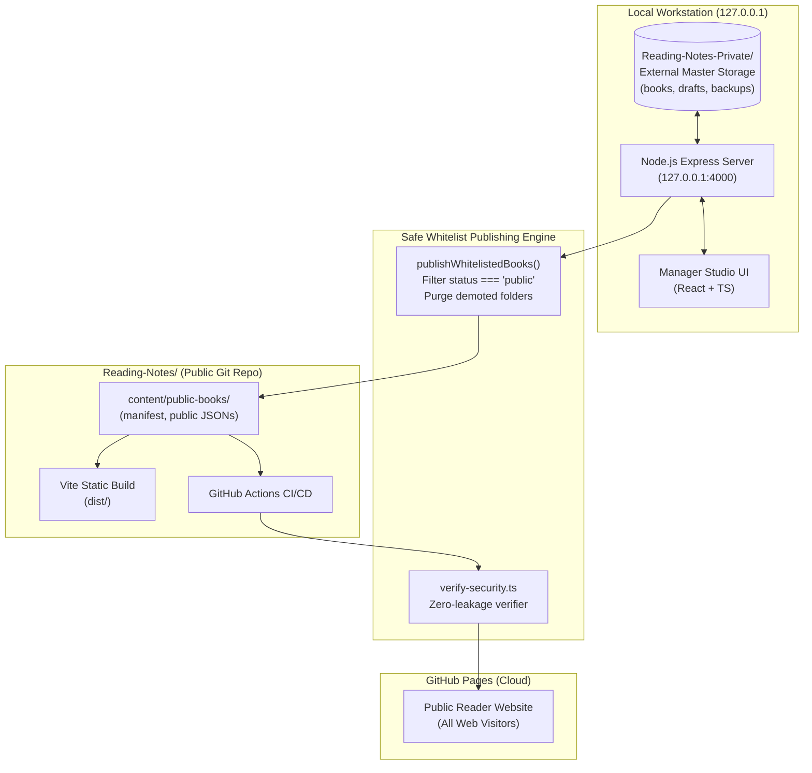

# Reading Notes 2.0 - Technical Architecture Document

## 1. System High-Level Overview

Reading Notes 2.0 adopts a **decoupled dual-tier architecture**:



---

## 2. Security & Privacy Isolation Model

### 2.1 Defense-in-Depth Storage Separation
1. **Physical Path Isolation**: The master private records reside in `Reading-Notes-Private/`, located **outside** the public git working tree by default (`../Reading-Notes-Private`).
2. **Repository Protection**: `.gitignore` strictly blocks any inadvertent tracking of `Reading-Notes-Private/`, `private-data/`, or `*.private.*`.
3. **Path Traversal Guards**: Every file system access goes through `safeResolve(baseDir, ...segments)`, checking that the canonical path starts with the authorized root, mitigating `../` or `..\` traversal attacks.
4. **Local Network Binding**: The local server is hardcoded to listen strictly on `127.0.0.1`. It never listens on `0.0.0.0`.
5. **DNS Rebinding Prevention**: Inbound requests inspect the `Host` header to ensure origin is `127.0.0.1` or `localhost`.

### 2.2 Whitelist Publishing Lifecycle
- **Status Enum**: `public` | `private` | `draft`.
- Only records explicitly tagged with `status: 'public'` are processed by `publishWhitelistedBooks()`.
- **Demotion Cleanup**: If a book previously published as `public` is switched to `private` or `draft`, the publisher removes its corresponding directory from `content/public-books/` and re-indexes the public manifest.

---

## 3. Data Schema Specifications

### 3.1 Book Metadata (`book.json`)
```typescript
interface Book {
  id: string;                         // Unique slug, e.g., 'the-effective-executive'
  title: string;
  subtitle?: string;
  author: string;
  publisher: string;
  publishDate: string;
  isbn: string;
  coverImage: string;
  category: string;
  tags: string[];
  startDate: string;
  finishDate?: string;
  status: 'public' | 'private' | 'draft';
  readingStatus: 'unread' | 'reading' | 'completed' | 'abandoned';
  progress: number;                   // 0 - 100
  totalPages?: number;
  currentPage?: number;
  motivation: string;
  introduction: string;
  coreIdea: string;
  chapters: ChapterMeta[];
  quotes?: QuoteItem[];
  createdAt: string;
  updatedAt: string;
}
```

### 3.2 Standard 8-Section Chapter Note Schema (`chapter-XX.json`)
```typescript
interface ChapterSections {
  introduction: {
    overview: string;
    learningGoals: string[];
    coreQuestions: string[];
  };
  summary: {
    mainArgument: string;
    contentDigest: string;
    keyPoints: string[];
  };
  professionalKnowledge: {
    definitions: string;
    terminology: string[];
    theories: string;
    citations: string;
  };
  vernacularExplanation: {
    plainText: string;
    everydayExamples: string;
  };
  caseAnalysis: {
    bookCases: string;      // Strictly author's original cases
    customCases: string;    // Reader's personal application cases
    application: string;
  };
  keyTakeaways: {
    takeaways: string[];
    comparisonTable?: string;
    diagramMarkdown?: string;
  };
  personalInsights: {
    reflections: string;
    agreedPoints: string;
    disagreedPoints: string;
    openQuestions: string;
  };
  chapterSummary: {
    coreKnowledge: string;
    conclusions: string;
    futureThoughts: string;
  };
}
```

---

## 4. REST API Endpoint Catalog (Local Manager)

All endpoints reside under `/api` listening on `127.0.0.1:4000`:

| Method | Path | Description |
| :--- | :--- | :--- |
| `GET` | `/api/health` | Health check, host binding check, and directory reports |
| `GET` | `/api/stats` | Global dashboard statistics (including private/draft counts) |
| `GET` | `/api/books` | Returns all master books |
| `GET` | `/api/books/:id` | Returns single book metadata |
| `POST` | `/api/books` | Create or update book |
| `DELETE` | `/api/books/:id` | Delete book |
| `GET` | `/api/books/:bookId/chapters/:chapterId` | Retrieve chapter with 8-section notes |
| `POST` | `/api/books/:bookId/chapters` | Save chapter |
| `DELETE` | `/api/books/:bookId/chapters/:chapterId` | Delete chapter |
| `POST` | `/api/books/:bookId/reorder` | Reorder chapters according to array of IDs |
| `GET` | `/api/publish/preview` | Diff inspection prior to publishing |
| `POST` | `/api/publish` | Execute safe whitelist synchronization |
| `POST` | `/api/backup` | Create timestamped JSON backup package |
| `GET` | `/api/backups` | List all existing backups |
| `POST` | `/api/restore` | Restore from a selected backup file |
| `GET` | `/api/export/markdown/:bookId` | Download bundled Markdown document of entire book |

